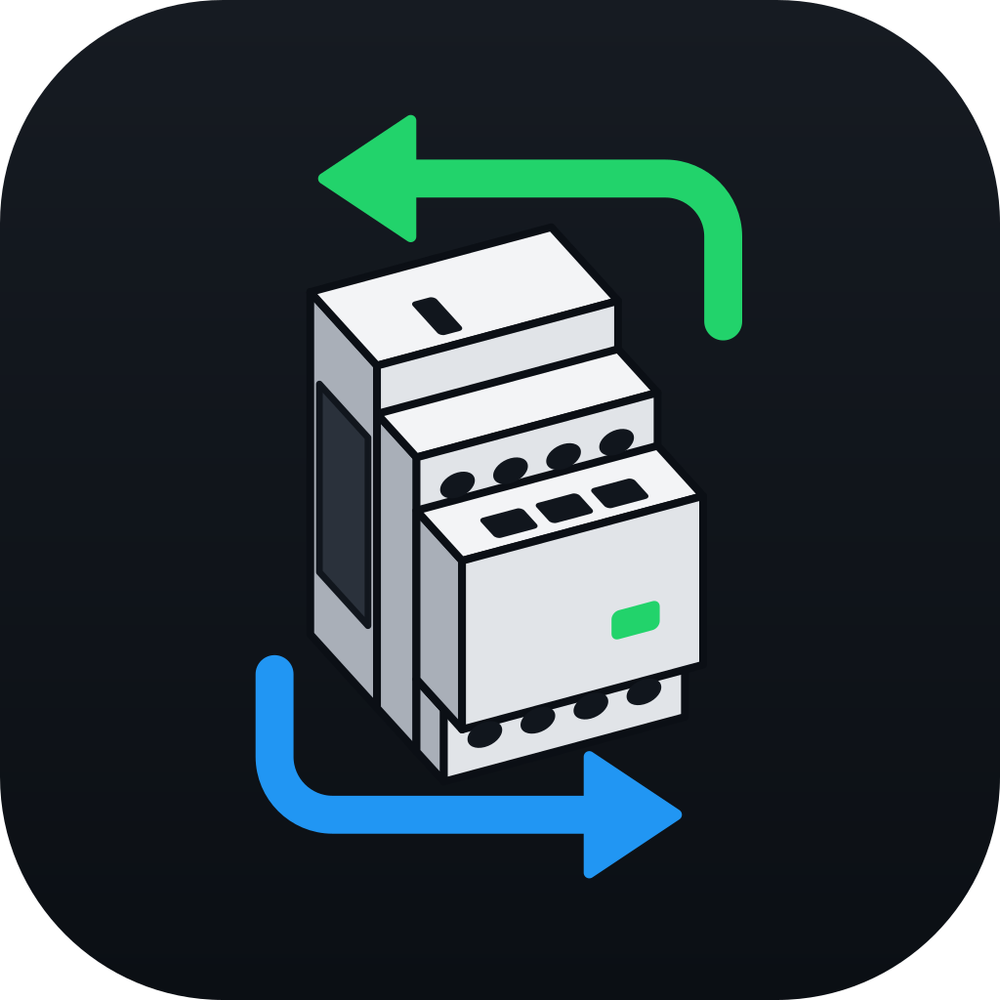
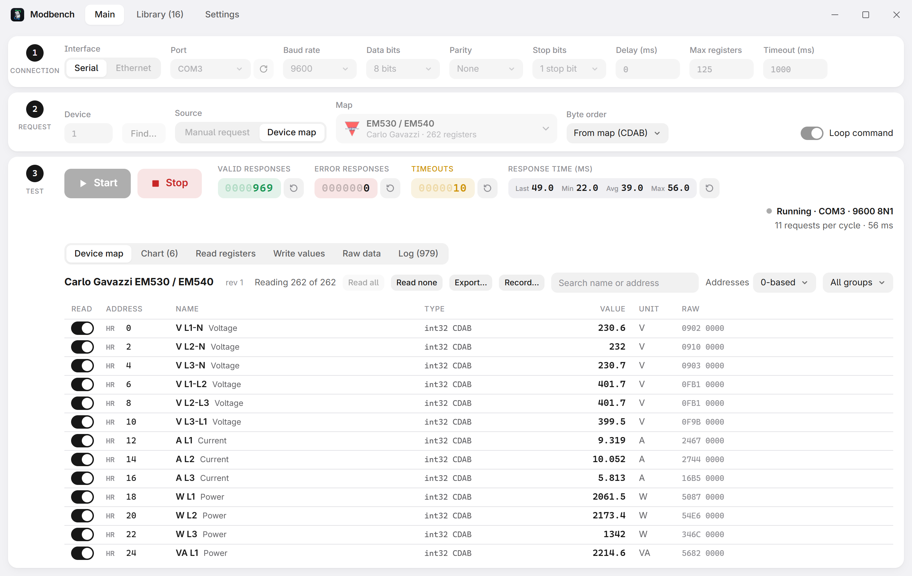
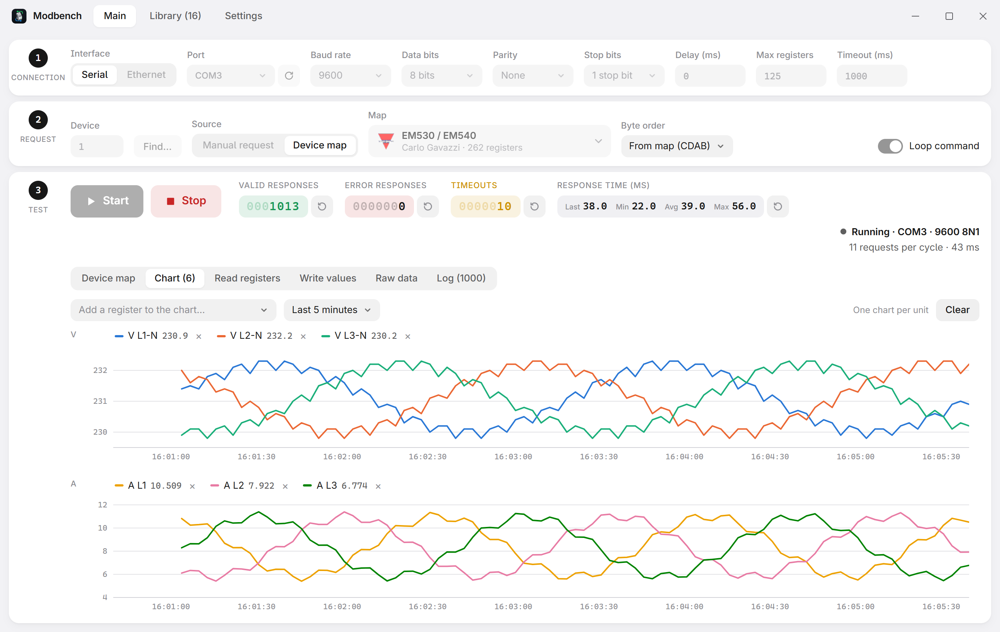
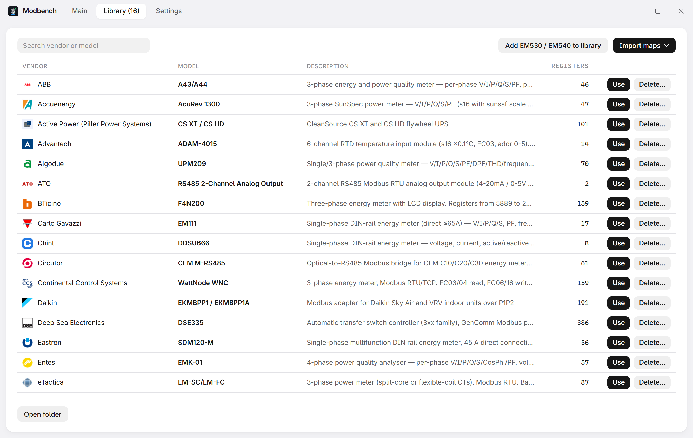
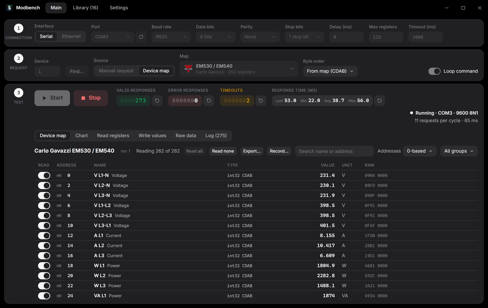

<p align="center"></p>

# Modbench

[](https://github.com/nobrega8/modbench/actions/workflows/ci.yml)
[](https://github.com/nobrega8/modbench/releases/latest)
[](https://github.com/nobrega8/modbench/releases)
[](#download)
[](https://tauri.app)
[](https://github.com/nobrega8/mbmap-library)
[](LICENSE)
[](https://ko-fi.com/nobrega)

A lightweight Modbus TCP/RTU/ASCII client for Windows, Linux and macOS ([website](https://nobrega8.github.io/modbench/)). Test any address by hand, or open a device map and read every register by name, already scaled, with units and labels.



## Download

Get the installer from [Releases](https://github.com/nobrega8/modbench/releases/latest): `Modbench_x.y.z_x64-setup.exe` (or `.msi`) for Windows 10/11, `Modbench_x.y.z_amd64.AppImage` (or `.deb`) for Linux, `Modbench_x.y.z_universal.dmg` for macOS 10.15+ (Apple Silicon and Intel). Modbench offers new versions when it starts.

On macOS the app is not notarized by Apple, so the first time, right-click Modbench in Applications and choose **Open** (or allow it under System Settings › Privacy & Security). Serial adapters appear as `/dev/cu.*`.

On Linux, add yourself to the `dialout` group to use serial ports: `sudo usermod -aG dialout $USER`, then log in again.

<details>
<summary>Install with APT (Debian, Ubuntu)</summary>

```sh
curl -fsSL https://nobrega8.github.io/modbench/key.asc | sudo gpg --dearmor -o /usr/share/keyrings/modbench.gpg
echo "deb [arch=amd64 signed-by=/usr/share/keyrings/modbench.gpg] https://nobrega8.github.io/modbench stable main" | sudo tee /etc/apt/sources.list.d/modbench.list
sudo apt update && sudo apt install modbench
```

Updates then arrive with `sudo apt upgrade`.
</details>

## Features

- **Manual requests**: any function code, address and quantity, over serial RTU or ASCII, Modbus TCP or UDP, or RTU over TCP or UDP.
- **Address notations**: show addresses 0-based, 1-based, in hex, in Modicon (`400101`) or IEC 61131-3 (`%MW100`) notation. Address fields take the last two as typed, and switch to their area.
- **Device maps**: open a [`.mbmap.json`](https://github.com/nobrega8/mbmap-library) and read every register by name, with types, byte and word order, scaling, units, bit fields and state labels. Browse and download over 400 shared maps from [mbmap-library](https://github.com/nobrega8/mbmap-library).
- **Checks the device**: reference values catch a wrong address or byte order, and a map can declare which models and firmware versions it fits.
- **Write safely**: typed controls for writable registers, limits from the map, optional confirmation, and a read-only mode that blocks every write.
- **Chart, raw bytes and log**: plot map registers, or addresses of a manual read, over time and save the charts as PNG or SVG, see the exact frames, export values or record every cycle to CSV.
- **Find devices**: scan for unit IDs, or for the baud rate, parity and stop bits of a serial device.
- **Tools**:
  - **Simulator**: Modbus devices inside Modbench, each optionally shaped after a map (its reference values and addresses), to try maps and other programs without hardware. Several devices answer their own unit IDs at one address, like devices behind a gateway or on one RS-485 line; other unit IDs stay silent. It listens on Modbus TCP or UDP, RTU over TCP or UDP, or a serial port (RTU or ASCII, with the baud rate, parity and stop bits you choose). Generators make values move on their own (increment, sine, random, or a copy of another address), in a map register's own units. Save setup… keeps the interface, devices, unit IDs, maps and generators in a `.mbsim` file to open again later, or with a double-click.
  - **Identify**: read the device's vendor, product code and revision (FC43).
  - **Find addresses**: discover which registers answer on a device without a manual.
  - **Data decoder** and **frame decoder**: hex as every type in every byte order, and frames field by field with CRC/LRC checks (also on the Raw data tab).
  - **Statistics**: failures by cause (timeouts, each exception, bad frames) and response times per function code, and a suggested timeout (4 × the slowest answer) that one click puts in step 1.
  - **Alarms**: low/high limits on map registers, shown in red on the Device map tab.
  - **Trend player**: play back a CSV recording with a scrub bar and up to 60× speed, and save the charts as an image.
- **Bit view**: see the 16 bits of each register and switch a single bit of a holding register.
- **Value templates**: copy the settings of one device to another of the same model.
- **Reconnects by itself** when a link drops during a test.
- Light and dark themes, adjustable text size, and small installers (about 2 MB on Windows).

| Chart | Device library | Dark theme |
|---|---|---|
|  |  |  |

<details>
<summary>What Modbench remembers</summary>

Everything stays on this computer. The last connection is filled in again on start. For each device (map + connection + unit ID), the registers you switched off, the byte order override and Loop come back; restoring them never writes or starts a test. Both can be turned off, and saved device choices forgotten, in Settings.
</details>

## User manual

Read the [user manual (PDF)](https://raw.githubusercontent.com/nobrega8/modbench/main/manual/modbench-manual.pdf). Its LaTeX source is in [`manual/`](manual/): build it with `latexmk` in that folder (see its README).

## Command line and MCP

`modbench-cli` reads devices without the UI. It never writes to a device.

```sh
modbench-cli read --tcp 192.168.1.10 holding 0x0405 1
modbench-cli map --rtu COM3 --unit 18 device.mbmap.json --filter voltage
modbench-cli scan --rtu COM3 --baud 9600 --from 1 --to 32
modbench-cli id --tcp 192.168.1.10               # FC43 device identification
modbench-cli read --udp 192.168.1.10 holding 0 10   # Modbus UDP
modbench-cli simulate device.mbmap.json --strict  # a simulated device on port 5020
modbench-cli simulate device.mbmap.json --generators moving.json
modbench-cli simulate device.mbmap.json --rtu-over-tcp   # RTU frames over TCP, like a gateway
modbench-cli simulate device.mbmap.json --rtu COM5 --baud 19200 --parity E
modbench-cli validate device.mbmap.json
modbench-cli convert old-device.mbmap          # version 1 map -> old-device.mbmap.json
```

`--generators` takes a JSON list. Each entry names a map register (in engineering units) or a raw `area` and `address`, a `kind`, and how often it changes (`every_ms`, default 1000, at least 50):

```json
[
  {"register": "Voltage L1", "kind": "sine", "offset": 230, "amplitude": 5, "period_s": 10, "every_ms": 500},
  {"area": "input", "address": 0, "kind": "increment", "step": 1, "min": 0, "max": 100},
  {"area": "holding", "address": 1, "kind": "random", "min": 10, "max": 20},
  {"area": "discrete", "address": 0, "kind": "copy", "from": {"area": "coil", "address": 0}}
]
```

Run `modbench-cli --help` for every command and option. `modbench-cli mcp` serves the same operations over [MCP](https://modelcontextprotocol.io) (stdio), so AI assistants such as Claude Code can read devices; `.mcp.json` registers it for this project.

## Development

Requirements: [Rust](https://rustup.rs), Node.js 22+ and the [Tauri prerequisites](https://tauri.app/start/prerequisites/).

```sh
npm install
npm run tauri dev       # run the app
npm run tauri build     # build the installers
```

No hardware? `cargo run --example simulator -- <map> 5020` (in `src-tauri`) serves a map over Modbus TCP on port 5020 with changing values.

CI runs `npm run format:check && npm run check && npm test` and, in `src-tauri`, `cargo fmt --check`, `cargo clippy --all-targets -- -D warnings` and `cargo test`.

To release, bump the version in `package.json`, `src-tauri/Cargo.toml` and `src-tauri/tauri.conf.json`, then push a `v*` tag: the Release workflow builds, signs and publishes the installers and the update manifest.

## License

Modbench is free software: you can redistribute it and/or modify it under the terms of the [GNU General Public License](LICENSE) as published by the Free Software Foundation, either version 3 of the License, or (at your option) any later version. A modified version you distribute, or a program built on Modbench's code, must be published under the same terms.

Releases up to 0.1.9 were published under the MIT licence, and those copies keep it. The device maps in [mbmap-library](https://github.com/nobrega8/mbmap-library) stay in the public domain (CC0).

## Funding

Modbench is free and open source. If it saves you time, you can support its development on Ko-fi:

<a href="https://ko-fi.com/nobrega"></a>
