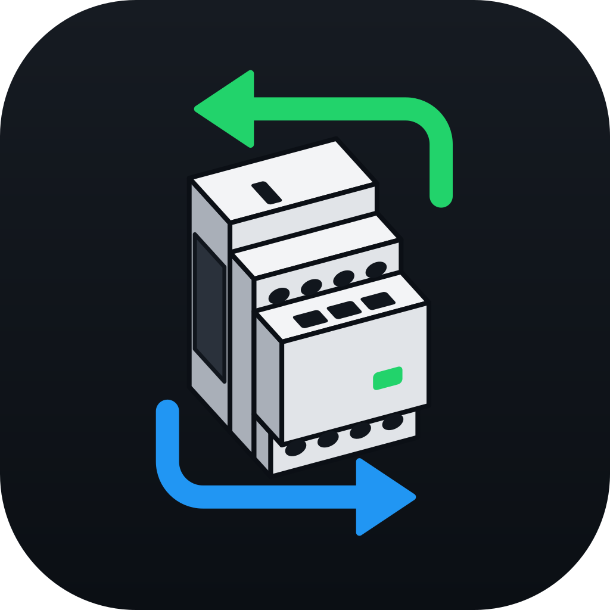
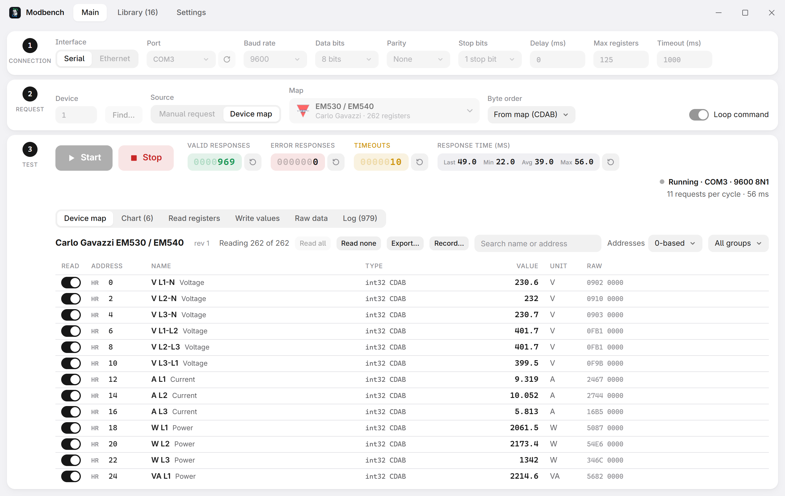
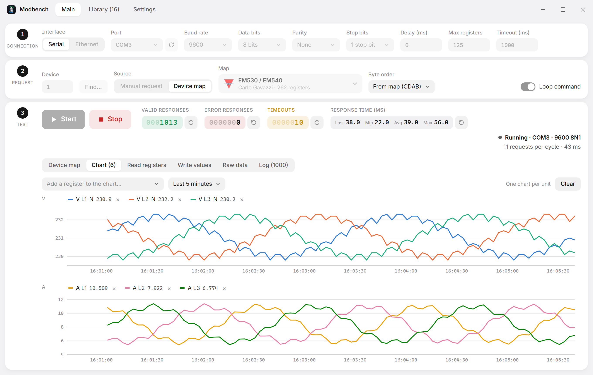
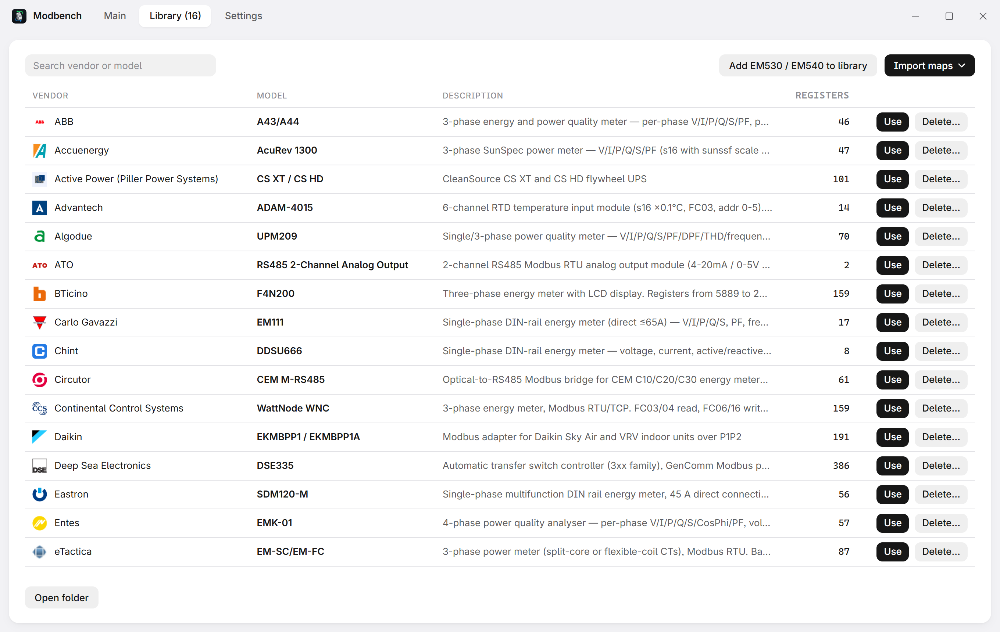
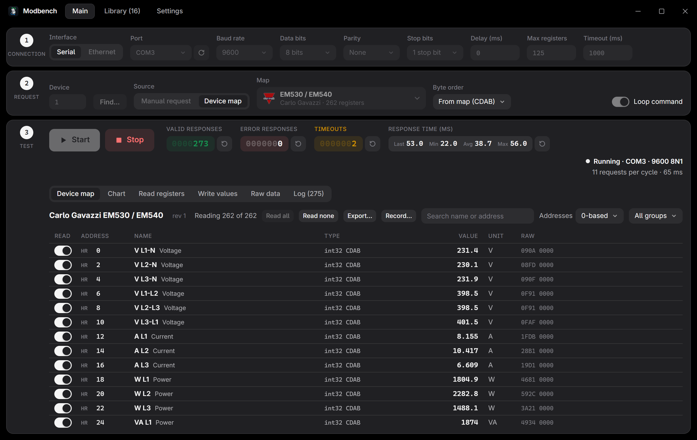

<p align="center"></p>

# Modbench

[English](../../README.md) · [Español](README_ES.md) · [简体中文](README_ZHS.md) · [日本語](README_JP.md) · **Русский**

[](https://github.com/nobrega8/modbench/actions/workflows/ci.yml)
[](https://github.com/nobrega8/modbench/releases/latest)
[](https://github.com/nobrega8/modbench/releases)
[](#скачать)
[](https://tauri.app)
[![Compatible with .mbmap](https://img.shields.io/badge/compatible-.mbmap-0A7EA4?logo=data:image/svg%2bxml;base64,PHN2ZyB4bWxucz0iaHR0cDovL3d3dy53My5vcmcvMjAwMC9zdmciIHZpZXdCb3g9IjAgMCAyNCAyNCIgZmlsbD0iI2ZmZmZmZiIgZmlsbC1ydWxlPSJldmVub2RkIj4KICA8dGl0bGU+bWJtYXA8L3RpdGxlPgogIDxnIHRyYW5zZm9ybT0idHJhbnNsYXRlKDAgLTAuNTUpIj4KICAgIDxyZWN0IHg9IjEuNDUiIHk9IjUuMyIgd2lkdGg9IjIuNiIgaGVpZ2h0PSIyLjYiIHJ4PSIwLjUiLz4KICAgIDxyZWN0IHg9IjUuOTUiIHk9IjUuMyIgd2lkdGg9IjIuNiIgaGVpZ2h0PSIyLjYiIHJ4PSIwLjUiLz4KICAgIDxyZWN0IHg9IjEwLjQ1IiB5PSI1LjMiIHdpZHRoPSIyLjYiIGhlaWdodD0iMi42IiByeD0iMC41Ii8+CiAgICA8cGF0aCBkPSJNMS41NSAxOS4zVjEyLjQ1QTMuNDUgMy40NSAwIDAgMSA3LjI1IDkuODM1QTMuNDUgMy40NSAwIDAgMSAxMi45NSAxMi40NVYxOS4zYTAuNSAwLjUgMCAwIDEtMC41IDAuNUgxMS4wNWEwLjUgMC41IDAgMCAxLTAuNS0wLjVWMTIuNDVBMS4wNSAxLjA1IDAgMCAwIDguNDUgMTIuNDVWMTkuM2EwLjUgMC41IDAgMCAxLTAuNSAwLjVINi41NWEwLjUgMC41IDAgMCAxLTAuNS0wLjVWMTIuNDVBMS4wNSAxLjA1IDAgMCAwIDMuOTUgMTIuNDVWMTkuM2EwLjUgMC41IDAgMCAxLTAuNSAwLjVIMi4wNWEwLjUgMC41IDAgMCAxLTAuNS0wLjVaIi8+CiAgICA8cGF0aCBkPSJNMTUuMDUgNS44YTAuNSAwLjUgMCAwIDEgMC41LTAuNUgxNi45NWEwLjUgMC41IDAgMCAxIDAuNSAwLjVWOUgxOUEzLjQ1IDMuNDUgMCAwIDEgMjIuNDUgMTIuNDVWMTYuMzVBMy40NSAzLjQ1IDAgMCAxIDE5IDE5LjhIMTUuNTVhMC41IDAuNSAwIDAgMS0wLjUtMC41Wk0xNy40NSAxMS40VjE3LjRIMTlBMS4wNSAxLjA1IDAgMCAwIDIwLjA1IDE2LjM1VjEyLjQ1QTEuMDUgMS4wNSAwIDAgMCAxOSAxMS40WiIvPgogIDwvZz4KPC9zdmc+Cg==)](https://github.com/nobrega8/mbmap-library)
[](../../LICENSE)
[](https://buymeacoffee.com/nobrega8)

Лёгкий клиент Modbus TCP/RTU/ASCII для Windows, Linux и macOS ([сайт](https://nobrega8.github.io/modbench/)). Проверяйте любой адрес вручную или откройте карту устройства и читайте каждый регистр по имени: уже с масштабом, единицами измерения и подписями состояний.

> Это перевод [английского README](../../README.md), который является основным и может быть новее.



## Скачать

Установщик можно скачать на странице [Releases](https://github.com/nobrega8/modbench/releases/latest): `Modbench_x.y.z_x64-setup.exe` (или `.msi`) для Windows 10/11, `Modbench_x.y.z_amd64.AppImage` (или `.deb`) для Linux на ПК и `Modbench_x.y.z_aarch64.AppImage` (или `_arm64.deb`) для Raspberry Pi и других 64-битных плат ARM, `Modbench_x.y.z_armhf.deb` для 32-битной Raspberry Pi OS (Bookworm или новее), `Modbench_x.y.z_universal.dmg` для macOS 10.15+ (Apple Silicon и Intel). Modbench предлагает новые версии при запуске.

В macOS приложение не нотаризовано Apple, поэтому в первый раз щёлкните Modbench в «Программах» правой кнопкой и выберите **Открыть** (или разрешите запуск в Системных настройках › Конфиденциальность и безопасность). Последовательные адаптеры отображаются как `/dev/cu.*`.

В Linux добавьте себя в группу `dialout`, чтобы пользоваться последовательными портами: `sudo usermod -aG dialout $USER`, затем войдите в систему заново.

<details>
<summary>Установка через APT (Debian, Ubuntu, Raspberry Pi OS)</summary>

Для `amd64` (ПК), `arm64` (Raspberry Pi 3, 4 и 5 с 64-битной системой, другие 64-битные платы ARM) и `armhf` (32-битная Raspberry Pi OS): Debian 12 и 13, Ubuntu 22.04 и новее, Raspberry Pi OS Bookworm или новее. APT сам выбирает пакет для машины. Raspberry Pi OS Buster и более старые не могут запускать Modbench (в них нет WebKitGTK 4.1).

```sh
curl -fsSL https://nobrega8.github.io/modbench/key.asc | sudo gpg --dearmor -o /usr/share/keyrings/modbench.gpg
echo "deb [signed-by=/usr/share/keyrings/modbench.gpg] https://nobrega8.github.io/modbench stable main" | sudo tee /etc/apt/sources.list.d/modbench.list
sudo apt update && sudo apt install modbench
```

Дальше обновления приходят через `sudo apt upgrade`. Список, написанный для старого выпуска с `arch=amd64`, продолжает работать на ПК; на Raspberry Pi замените его строкой выше.
</details>

<details>
<summary>Установка в Arch Linux (x86_64)</summary>

В каждом выпуске есть пакет для Arch, `modbench-x86_64.pkg.tar.zst`. Репозиторий не нужен:

```sh
sudo pacman -U https://github.com/nobrega8/modbench/releases/latest/download/modbench-x86_64.pkg.tar.zst
```

Для обновления выполните ту же команду.
</details>

## Возможности

- **Ручные запросы**: любой код функции, адрес и количество, по последовательному RTU или ASCII, Modbus TCP или UDP, а также RTU поверх TCP или UDP.
- **Modbus/TCP Security**: Modbus TCP внутри TLS (порт 802), с проверкой сертификата устройства по удостоверяющему центру (или без проверки) и предъявлением клиентского сертификата устройствам, которые его требуют.
- **Нотации адресов**: показывайте адреса с нуля, с единицы, в шестнадцатеричном виде, в нотации Modicon (`400101`) или IEC 61131-3 (`%MW100`). Поля адреса принимают последние две нотации в том виде, как они введены, и переключаются на нужную область.
- **Карты устройств**: откройте [`.mbmap.json`](https://github.com/nobrega8/mbmap-library) и читайте каждый регистр по имени, с типами, порядком байтов и слов, масштабированием, единицами, битовыми полями и подписями состояний. Столбец FC показывает код функции, которым читается каждый регистр, а правый щелчок читает регистр другой функцией (FC03 или FC04), если устройство отвечает только на одну из них. Более 400 общих карт можно просматривать и скачивать из [mbmap-library](https://github.com/nobrega8/mbmap-library).
- **Конструктор карт**: на вкладке «Библиотека» отдельное окно, где карту пишут по руководству: заголовок устройства, таблица регистров (область, адрес как в руководстве, тип, масштаб, единица, доступ, подписи состояний, описание) и сообщения валидатора в каждой строке прямо при вводе. Сохраняет `.mbmap.json` версии 2. То же окно редактирует существующую карту: щёлкните правой кнопкой карту в Библиотеке или регистр на вкладке «Карта устройства» и выберите пункт редактирования. Список изменений показывает отличия от оригинала. **Сохранить** записывает карту из библиотеки обратно в её файл (после этого Библиотека помечает её как изменённую), помещает новую карту в библиотеку под её производителем и моделью (спрашивая перед заменой существующей) и записывает карту, открытую из другой папки, обратно в тот файл; **Сохранить как…** записывает файл куда угодно.
- **Проверка устройства**: эталонные значения выявляют неверный адрес или порядок байтов, а карта может указывать, каким моделям и версиям прошивки она подходит.
- **Безопасная запись**: типизированные элементы управления для записываемых регистров, пределы из карты, необязательное подтверждение и режим «только чтение», блокирующий любую запись.
- **График, сырые байты и журнал**: стройте графики регистров карты или адресов ручного чтения во времени (колесо масштабирует ось времени, перетаскивание сдвигает её, Shift + перетаскивание приближает выбранный диапазон, диапазон можно задать маркерами) и сохраняйте графики в PNG или SVG, смотрите точные кадры, экспортируйте значения или записывайте каждый цикл в CSV.
- **Поиск устройств**: сканирование идентификаторов устройств (unit ID), а также скорости, чётности и стоповых битов последовательного устройства.
- **Инструменты**:
  - **Симулятор**: устройства Modbus внутри Modbench, каждое при желании по образцу карты (её эталонные значения и адреса), чтобы пробовать карты и другие программы без оборудования. Несколько устройств отвечают на свои unit ID по одному адресу, как устройства за шлюзом или на одной линии RS-485; остальные unit ID молчат. Слушает Modbus TCP или UDP, RTU поверх TCP или UDP либо последовательный порт (RTU или ASCII, со скоростью, чётностью и стоповыми битами по вашему выбору). Генераторы заставляют значения меняться сами (приращение, синус, случайное значение или копия другого адреса) в единицах самого регистра карты. «Сохранить настройку…» записывает интерфейс, устройства, unit ID, карты и генераторы в файл `.mbsim`, который можно открыть позже или двойным щелчком.
  - **Шлюз**: передаёт запросы клиентов с одного канала устройству из шага 1 на другом (Modbus TCP или UDP, RTU поверх TCP или UDP либо последовательный порт с любой стороны), как шлюз «последовательный порт ↔ Ethernet» на столе, с перечнем всех запросов. Молчащее устройство возвращается как исключение 0x0B, отсутствующий канал как 0x0A; шлюз умеет переписывать unit ID и отклонять запись.
  - **Монитор шины**: слушает линию RS-485, где мастер уже общается со своими устройствами, не отправляя ни байта, и показывает каждый запрос с ответом в расшифрованном виде: значения, исключения, запросы без ответа и неверные CRC, с фильтрами и экспортом в CSV.
  - **Идентификация**: читает производителя, код продукта и ревизию устройства (FC43).
  - **Поиск адресов**: выясняет, какие регистры отвечают у устройства без руководства.
  - **Декодер данных** и **декодер кадров**: шестнадцатеричные данные как любой тип в любом порядке байтов, а кадры по полям с проверкой CRC/LRC (также на вкладке «Сырые данные»).
  - **Статистика**: сбои по причинам (тайм-ауты, каждое исключение, неверные кадры) и время ответа по кодам функций, а также предлагаемый тайм-аут (4 × самый медленный ответ), который одним щелчком подставляется в шаг 1.
  - **Аварийные сигналы**: нижние и верхние пределы для регистров карты, выделяются красным на вкладке «Карта устройства».
  - **Тестовая последовательность**: для пусконаладки, шаги над регистрами карты (записать значение, подождать, ожидать значение или диапазон в течение времени, прочитать регистр для записи результата), сохраняется как `.mbtest.json`, с результатом по каждому шагу и отчётом в HTML.
  - **Проигрыватель трендов**: воспроизводит запись CSV с ползунком и скоростью до 60× и сохраняет графики как изображение.
- **Битовое представление**: показывает 16 бит каждого регистра и переключает отдельный бит регистра хранения.
- **Экспорт в другое ПО**: запишите карту как конфигурацию Modbus для Home Assistant, датчики ESPHome, вход Telegraf, поток Node-RED или список тегов CSV, с адресом устройства из соединения (правый щелчок по карте в Библиотеке).
- **Шаблоны значений**: копируйте настройки одного устройства на другое той же модели.
- **Сам переподключается**, если связь пропала во время теста.
- Светлая и тёмная темы, настраиваемый размер текста и небольшие установщики (около 2 МБ в Windows).

| График | Библиотека устройств | Тёмная тема |
|---|---|---|
|  |  |  |

<details>
<summary>Что запоминает Modbench</summary>

Всё остаётся на этом компьютере. Последнее соединение подставляется снова при запуске. Для каждого устройства (карта + соединение + unit ID) возвращаются отключённые вами регистры, принудительно выбранные коды функций, переопределение порядка байтов и Loop; восстановление никогда ничего не записывает и не запускает тест. И то и другое можно отключить, а сохранённые выборы устройств забыть, в Настройках.
</details>

## Руководство пользователя

Читайте [руководство пользователя (PDF)](https://raw.githubusercontent.com/nobrega8/modbench/main/manual/modbench-manual.pdf). Его исходный код на LaTeX находится в [`manual/`](../../manual/): соберите его командой `latexmk` в этой папке (см. README там).

## Командная строка и MCP

`modbench-cli` читает устройства без интерфейса. Он никогда ничего не записывает в устройство, кроме шагов записи тестовой последовательности, запущенной с `--allow-writes`.

```sh
modbench-cli read --tcp 192.168.1.10 holding 0x0405 1
modbench-cli map --rtu COM3 --unit 18 device.mbmap.json --filter voltage
modbench-cli scan --rtu COM3 --baud 9600 --from 1 --to 32
modbench-cli id --tcp 192.168.1.10               # идентификация устройства FC43
modbench-cli read --udp 192.168.1.10 holding 0 10   # Modbus UDP
modbench-cli read --tcp 192.168.1.10 --tls --ca ca.pem --cert me.pem --key me.key holding 0 1   # Modbus/TCP Security, порт 802
modbench-cli simulate device.mbmap.json --strict  # симулируемое устройство на порту 5020
modbench-cli simulate device.mbmap.json --generators moving.json
modbench-cli simulate device.mbmap.json --rtu-over-tcp   # кадры RTU поверх TCP, как у шлюза
modbench-cli simulate device.mbmap.json --rtu COM5 --baud 19200 --parity E
modbench-cli simulate device.mbmap.json --tls-cert server.pem --tls-key server.key --tls-client-ca ca.pem   # внутри TLS
modbench-cli gateway --listen tcp:0.0.0.0:5502 --rtu COM3 --baud 9600   # клиенты Modbus TCP -> устройство RTU
modbench-cli monitor --rtu COM3 --baud 19200 --parity E   # слушать линию, ничего не отправляя
modbench-cli test --tcp 192.168.1.10 device.mbmap.json start.mbtest.json --allow-writes --report out.html
modbench-cli validate device.mbmap.json
modbench-cli convert old-device.mbmap          # карта версии 1 -> old-device.mbmap.json
modbench-cli export device.mbmap.json -f home-assistant --tcp 192.168.1.10   # или esphome, telegraf, node-red, csv
```

`--generators` принимает список JSON. Каждый элемент называет регистр карты (в технических единицах) либо сырые `area` и `address`, `kind` и частоту изменения (`every_ms`, по умолчанию 1000, не менее 50):

```json
[
  {"register": "Voltage L1", "kind": "sine", "offset": 230, "amplitude": 5, "period_s": 10, "every_ms": 500},
  {"area": "input", "address": 0, "kind": "increment", "step": 1, "min": 0, "max": 100},
  {"area": "holding", "address": 1, "kind": "random", "min": 10, "max": 20},
  {"area": "discrete", "address": 0, "kind": "copy", "from": {"area": "coil", "address": 0}}
]
```

Выполните `modbench-cli --help`, чтобы увидеть все команды и параметры. `modbench-cli mcp` предоставляет те же операции по [MCP](https://modelcontextprotocol.io) (stdio), так что ИИ-ассистенты, например Claude Code, могут читать устройства; `.mcp.json` регистрирует его для этого проекта.

Чтобы ассистент работал в запущенном окне (открыл карту, изменил соединение, запустил цикл, показал график), включите **Let an assistant control Modbench** в Настройки > Соединение. По умолчанию это выключено и только локально (порт на loopback и файл с токеном); инструменты `gui_*` пересылаются в окно, панель показывает, что сделал ассистент, и позволяет приостановить его или отключить, и он никогда ничего не записывает в устройство. См. руководство, главу *Command line*.

## Разработка

Требования: [Rust](https://rustup.rs), Node.js 22+ и [зависимости Tauri](https://tauri.app/start/prerequisites/).

```sh
npm install
npm run tauri dev       # запустить приложение
npm run tauri build     # собрать установщики
```

Нет оборудования? `cargo run --example simulator -- <map> 5020` (в `src-tauri`) отдаёт карту по Modbus TCP на порту 5020 с изменяющимися значениями.

CI выполняет `npm run format:check && npm run check && npm test` и, в `src-tauri`, `cargo fmt --check`, `cargo clippy --all-targets -- -D warnings` и `cargo test`.

Для выпуска увеличьте версию в `package.json`, `src-tauri/Cargo.toml` и `src-tauri/tauri.conf.json`, затем отправьте тег `v*`: рабочий процесс Release соберёт, подпишет и опубликует установщики и манифест обновлений.

## Лицензия

Modbench — свободное программное обеспечение: вы можете распространять и изменять его на условиях [GNU General Public License](../../LICENSE), опубликованной Free Software Foundation, версии 3 или (по вашему выбору) любой более поздней. Изменённую версию, которую вы распространяете, или программу, построенную на коде Modbench, необходимо публиковать на тех же условиях.

Выпуски до 0.1.9 были опубликованы под лицензией MIT, и эти копии сохраняют её. Карты устройств в [mbmap-library](https://github.com/nobrega8/mbmap-library) остаются в общественном достоянии (CC0).

## Поддержка проекта

Modbench бесплатен и имеет открытый исходный код. Если он экономит вам время, вы можете поддержать его разработку на Buy Me a Coffee:

<a href="https://buymeacoffee.com/nobrega8"></a>
